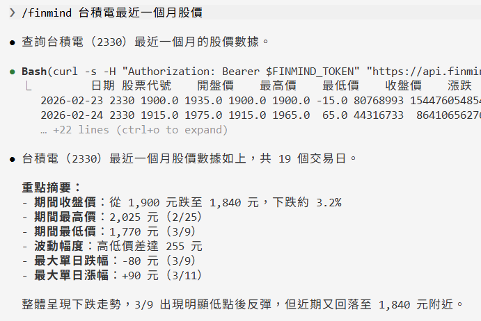

# MCP Server

If your AI tool supports [MCP (Model Context Protocol)](https://modelcontextprotocol.io/), you can use the official FinMind MCP server [`finmind-mcp`](https://pypi.org/project/finmind-mcp/) instead — the tool calls it automatically and **fetches real data**, with no skill file to download. It is best suited to multi-turn, agentic queries and analysis.

!!! tip "Other connection methods"
    - Web ChatGPT / Claude: use [llms.txt](Llms.md) — no install.
    - CLI tools that prefer a command file: use [Agent Skill](AgentSkill.md).

## Installation { #install }

First register at [FinMind](https://finmindtrade.com/analysis/#/account/register) to get a token.

**Claude Desktop (one-click, no Python or config editing needed):** download [finmind.mcpb](https://github.com/FinMind/FinMind-MCP/releases/latest/download/finmind.mcpb), double-click it, and paste your token in the install dialog. If double-clicking does nothing, open Claude Desktop → Settings → Extensions and drag the file into the window.

**Claude Code (one-click):** first `export FINMIND_TOKEN=your_token_here`, then run inside Claude Code:

```
/plugin marketplace add FinMind/FinMind-MCP
/plugin install finmind-mcp@finmind-official
```

After install, run `/reload-plugins` to connect and `/mcp` to verify. (The plugin reads `${FINMIND_TOKEN}` from the environment, so export it before launching Claude Code.)

**Other tools (Cursor / Windsurf / Gemini CLI, or Claude Desktop if you prefer manual setup):** install [uv](https://docs.astral.sh/uv/) first, then add this to the tool's MCP config file:

```json
{
  "mcpServers": {
    "finmind": {
      "command": "uvx",
      "args": ["finmind-mcp"],
      "env": { "FINMIND_TOKEN": "your_token_here" }
    }
  }
}
```

**Codex CLI** uses a different config format (`[mcp_servers]` in `~/.codex/config.toml`), or a one-liner: `codex mcp add finmind --env FINMIND_TOKEN=... -- uvx finmind-mcp`.

!!! tip "Windows users"
    For Claude Desktop, the one-click install above is all you need. For other tools, the commands above use macOS / Linux syntax; on Windows, use **PowerShell** instead:

    - Install uv: `winget install --id astral-sh.uv -e` (close and reopen PowerShell afterwards so PATH takes effect), then verify with `uvx finmind-mcp --help`.
    - Set the token: `$env:FINMIND_TOKEN = "your_token_here"` (current window only) or `setx FINMIND_TOKEN "your_token_here"` (persistent; restart apps to pick it up) — or simply put it in the config file's `env` block above, which is the most reliable option.
    - If your tool (e.g. Claude Desktop) reports the command not found or fails to connect: GUI apps see a different PATH than your terminal. First fully quit and reopen the tool — that usually fixes it. If not, run `where.exe uvx` to find the full path (for a winget install, typically `C:\Users\<name>\AppData\Local\Microsoft\WinGet\Links\uvx.exe`; use the first line it prints) and use it as `command` in the config. In JSON, write every backslash as `\\` (or use forward slashes `/`) — pasting single backslashes makes the config file invalid JSON.

    For the full walkthrough (pipx route, per-host Windows config paths, troubleshooting), see the [Windows installation guide](https://github.com/FinMind/FinMind-MCP/blob/master/install/windows.md).

For per-host config file locations, the `claude mcp add` / `gemini mcp add` / `codex mcp add` one-liners, and verification steps, see the [FinMind-MCP install guides](https://github.com/FinMind/FinMind-MCP/tree/master/install).

## Available tools { #tools }

Since version 0.1.0, the MCP server can access all public FinMind data and endpoints, including whole-day, market-wide downloads (storage_objects); version 0.1.1 adds financial report and annual report PDFs (`download_financial_report`). It provides 8 tools, which your AI tool picks automatically based on your question:

| Tool | Purpose |
|---|---|
| `query_dataset` | General query by dataset, ID and date range (every dataset on `/api/v4/data`) |
| `list_datasets` | List all datasets with the required membership tier and descriptions (no token needed) |
| `get_stock_info` | Taiwan stock IDs, names and industries |
| `query_trading_daily_report` | Single-day branch trading, by stock or by securities trader branch |
| `query_endpoint` | Other dedicated endpoints: daily branch aggregate statistics (SecIdAgg), warrant branch reports, real-time stock / futures / options snapshots, `datalist`, `translation` |
| `download_storage_object` | Download whole-day, market-wide data (ticks, minute K, branch reports, etc.) to your machine; returns the file path, row count, columns and first rows, with optional filtering by ID / branch |
| `download_financial_report` | Download a listed company's [financial report or annual report PDF](https://finmind.github.io/en/tutor/TaiwanMarket/Fundamental/#taiwan-stock-financial-report-and-annual-report-pdf-taiwanstockfinancialreportfile-available-only-to-sponsorpro-members) and read its table of contents, specific pages, or pages containing a keyword (e.g. revenue breakdowns or inventory composition in the notes) |
| `get_pricing` | Membership plan prices and licensing (no token needed) |

Access depends on your membership tier. When a query exceeds your plan, the tool tells you which plan is required (Backer / Sponsor / Sponsor Pro) and links to the [upgrade page](https://finmindtrade.com/analysis/#/Sponsor/sponsor).

??? note "Whole-day downloads (`download_storage_object`)"
    - Whole-day downloads are available only to [sponsorpro](https://finmindtrade.com/analysis/#/Sponsor/sponsor) members.
    - Whole-day files are often tens of MB, so the tool returns only a summary (up to 500 rows); the full file is saved locally and can be read with `pandas.read_parquet(path)`.
    - Files are saved under `finmind-mcp/storage_objects/` in your user cache directory by default; set the `FINMIND_DOWNLOAD_DIR` environment variable to change the location. Repeated queries for the same dataset and day reuse the local file.
    - The summary requires `pyarrow`. The Claude Desktop one-click install already includes it; other tools do not install it by default (the file is still downloaded and its path returned). To get summaries, change `args` in your config to `["--from", "finmind-mcp[parquet]", "finmind-mcp"]`.

??? note "Financial report PDFs (`download_financial_report`)"
    - Requires version 0.1.1 or later (`uvx` picks it up automatically; Claude Desktop users should download finmind.mcpb again).
    - Available only to [sponsorpro](https://finmindtrade.com/analysis/#/Sponsor/sponsor) members.
    - No need to download files yourself or install a PDF reader: the tool first returns the cover and table of contents, then the AI reads the notes by page number or finds pages by keyword.
    - Each call returns up to about 30,000 characters; files are cached locally, so the same report is not downloaded again.
    - In some PDFs the main statement pages are images, and some annual reports have a corrupted text layer; the tool flags these pages instead of returning garbled text. For income statement, balance sheet and cash flow figures, query the three financial statement datasets instead.

## Examples { #examples }

> MCP is called automatically by the tool, so just ask in natural language — **no `/finmind` prefix needed**. It is best for follow-up questions and cross-dataset agentic analysis.

### Ask Directly

```
How have TSMC's stock prices trended over the past month?
```

> Expected result: the tool automatically calls `query_dataset` (TaiwanStockPrice), returns TSMC (2330) daily prices for the past month, and summarizes the trend.



### Multi-Turn Follow-Up

```
What were 2330's institutional net buy/sell over the past week? Are foreign investors net buyers or sellers?
Then compare it with 2317 over the same period.
```

> Expected result: it first returns TSMC institutional net buy/sell and reads the foreign-investor direction, then continues in the same conversation to query Hon Hai and compare — no need to re-enter the conditions.

### Cross-Dataset Analysis

```
Analyze TSMC's stock return over the past year, compare it against monthly revenue growth over the same period, and give me a conclusion.
```

> Expected result: the tool fetches price and monthly-revenue data separately, computes the return and YoY revenue growth, and synthesizes a written conclusion.

### Conditional Screening

```
Which 5 stocks had the highest institutional net-buy value today?
```

> Expected result: the tool queries today's institutional trading data, sorts it, and returns the top 5 stocks by net-buy value.

### Branch Aggregate Statistics (Sponsor)

```
How many shares of TSMC did 合庫 (1020) buy and sell each day from 7/1 to 7/5?
```

> Expected result: the tool calls `query_endpoint` (TaiwanStockTradingDailyReportSecIdAgg) and returns 合庫's daily buy/sell shares and average prices for TSMC over that period.

### Whole-Day Market-Wide Download (Sponsor Pro)

```
Download the whole-day minute K file for 10/16 and give me the TSMC part.
```

> Expected result: the tool calls `download_storage_object` to save the whole-day file locally, returns the file path, and filters out TSMC's minute K bars.

### Read Financial Report Notes (Sponsor Pro)

```
TSMC's inventory jumped in Q2 2026. Is it unsold finished goods? Check the notes in the financial report.
```

> Expected result: the tool first calls `query_dataset` on the balance sheet to confirm the inventory change, then calls `download_financial_report` to find the inventory note in the financial report and answers based on the split between finished goods, work in process and raw materials.

## Data field caveats { #caveats }

The following are common field-definition differences to keep in mind when an AI agent interprets query results (Taiwan stock prices, futures / options ticks). They are not data errors:

??? warning "Emerging stocks: `open` is the *previous-day average price*, and may fall outside the day's high/low (not a data error)"
    Emerging-board stocks trade by negotiation and **have no opening price**. For emerging stocks this table therefore fills `open` with the **previous-day average price**, not an opening price; `max` / `min` / `close` are still the day's high / low / last traded price and are correct.

    As a result, an emerging stock's `open` can sit above `max` or below `min` on volatile days. This is a **field-definition difference, not corrupt data**. For candlestick charts, use `max` / `min` / `close`, or treat `open` as the previous-day average.

    **Example**: 6515 穎崴 on 2020-03-19 (emerging at the time) → `open=218.06`, `max=200`, `min=170`, `close=174.9`; 218.06 is exactly the previous-day average that day. The stock later moved to TWSE, after which its data is normal.

??? note "Futures ticks (TaiwanFuturesTick): how volume is counted"
    Tick volume is counted on a **double-sided** basis: each matched trade records both the buy side and the sell side once. As a result, the summed tick volume is about **2×** the (single-side) volume in the daily data TaiwanFuturesDaily; for spread / combination orders, which contain two legs, the tick volume is about **4×** the daily volume. Convert accordingly when reconciling tick volume against daily volume.

    **Per-contract-month reconciliation**: for a given contract month (e.g. 202606) within the same trading session,

    `sum of volume of outright rows (contract_date = 202606) + sum of volume of spread rows containing that month (e.g. 202606/202607) ÷ 2 = 2 × TaiwanFuturesDaily volume of that month − 2 × negotiated block-trade lots of that month`

    - The volume of a spread row is exactly 4× the volume of the corresponding spread contract (contract_date with two months) in TaiwanFuturesDaily. Each spread lot counts toward the daily volume of both legs, so divide spread volume by 2 when attributing it to a single month; do not add it in full.
    - **Negotiated block trades are not included in tick data, but are included in daily volume.** They occur mostly as rollovers ahead of settlement (equal lots in the near and next months) and are the main reason tick volume falls noticeably short of 2× daily volume around settlement week; this is not missing tick data. Details are published on the TAIFEX website under "Market Data > Daily Market Report > Block Trade > Negotiation": trades in the regular trading session count toward the regular session (position), and after-hours trades count toward that trading day's after-hours session (after_market).

??? note "Futures ticks: trading-day attribution of after-hours ticks"
    The after-hours (night) session follows the TAIFEX rule of being attributed to the **next business day**. The after-hours session for trading day D is the segment running from 15:00 on the previous business day until 05:00 on day D. Therefore, within a tick file:

    - **00:00–05:00** ticks belong to the after-hours (after_market) session of **trading day D** in TaiwanFuturesDaily.
    - **08:45–13:45** ticks belong to the regular session (position) of trading day D.
    - **15:00–24:00** ticks belong to the after-hours session of the **next trading day**.

??? note "Options ticks (TaiwanOptionTick): how volume is counted"
    As with futures ticks, options tick volume is counted on a **double-sided** basis: each matched trade records both the buy side and the sell side once, typically appearing as two identical rows; these are not duplicates. The summed tick volume is about **2×** the (single-side) volume in the daily data TaiwanOptionDaily.

    **Per-series reconciliation**: for a given series (same contract_date, strike and call/put) within the same trading session,

    `sum of tick volume of that series = 2 × TaiwanOptionDaily volume of that series − 2 × negotiated block-trade lots of that series`

    - Negotiated block trades are not included in tick data, but are included in daily volume; this is not missing tick data.
    - Tick data has **no buy/sell-initiated (aggressor side) field**.
    - Trading-day attribution of after-hours ticks is the same as for futures: 00:00–05:00 belongs to trading day D's after-hours session (after_market), 15:00–24:00 to the next trading day's after-hours session.
